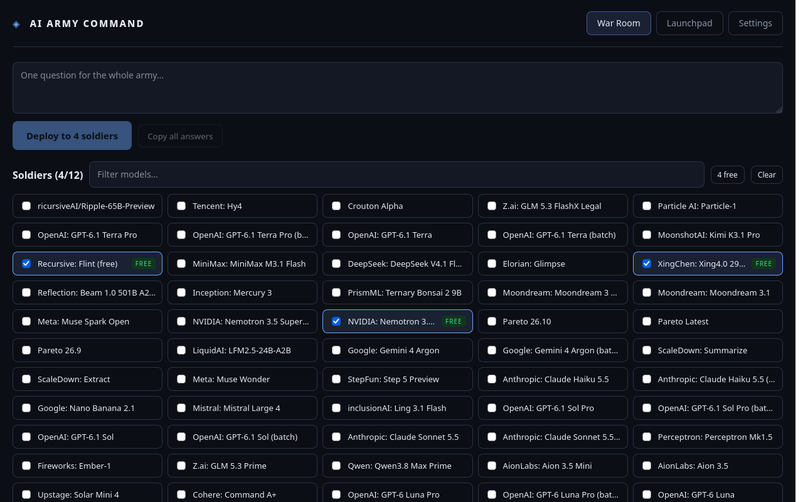

# AI Army Command

A self-hosted mission-control dashboard for your army of AI chatbots. One question, many models, live answer boxes — plus a launchpad for the big web chat apps. And now a **Barracks**: real subagents with tools that run multi-step missions.



```
ai-army/
├── backend/            # Express API — keys live here, never in the browser
│   └── src/
│       ├── server.js          # app wiring, static frontend serving
│       ├── config.js          # env parsing + startup safety warnings
│       ├── middleware/
│       │   └── security.js    # helmet, CORS, rate limits
│       ├── routes/
│       │   └── api.js         # /api/* endpoints
│       ├── services/
│       │   ├── openrouter.js  # model roster + parallel streaming fan-out
│       │   └── tileStore.js   # custom launchpad tiles (JSON persistence)
│       └── data/
│           └── custom-tiles.json
├── frontend/           # React + Vite — one file per component
│   └── src/
│       ├── App.jsx
│       ├── api.js             # fetch wrapper + SSE stream parser
│       ├── data/builtinTiles.js
│       └── components/
│           ├── WarRoom.jsx        # pick soldiers, ask once, watch them work
│           ├── RosterPicker.jsx   # model selection
│           ├── SoldierCard.jsx    # one live answer box
│           ├── Launchpad.jsx      # web-app tiles + custom tile manager
│           ├── TileCard.jsx
│           ├── CustomTileForm.jsx
│           └── SettingsPanel.jsx
├── Dockerfile
├── docker-compose.yml
└── DEPLOY.md           # how to put this on the internet, securely
```

## Quickstart (local)

```bash
cp .env.example .env        # then fill in OPENROUTER_API_KEY
npm run install:all
npm run build               # build the frontend once

# terminal 1
npm run dev:backend
# terminal 2
npm run dev:frontend
```

Open http://localhost:5173 (dev) — or just `npm start` and open http://localhost:3001 (serves the built frontend).

## The Barracks (subagent fleet)

The War Room asks one question of many models. The Barracks goes further: persistent **agents** (name + provider + model + system prompt + tools) that run **missions** — multi-step jobs with an agentic loop (think → call tool → observe → repeat, max 10 steps).

- **Providers**: Gemini free API, OpenRouter (`:free` models cost $0), Ollama for local models. ChatGPT/Claude web stay as launchpad tabs — no free API exists for them.
- **Tools**: `read_file` / `write_file` (jailed to `AI_ARMY_WORKDIR`), `run_shell` (timeout, scrubbed env), `web_fetch`. Risky shell commands pause the mission and ask you for one-tap approval in the UI.
- **Safety**: API keys never enter prompts; shell env is scrubbed of secrets; agents can't read `.env`/`.ssh`/key-like paths; per-provider concurrency caps with backoff on 429s.
- Dispatch from the Barracks tab, watch each agent's step feed live, approve risky commands inline, and find every finished mission in the inbox.

## Why a backend

- Your OpenRouter key stays in `.env` on the server. The browser never sees it.
- No CORS hacks — the server talks to providers directly.
- Custom launchpad tiles persist server-side and follow you across devices.

See **DEPLOY.md** for remote-access options (Cloudflare Tunnel, VPS, Railway/Render/Fly) and the security checklist.
